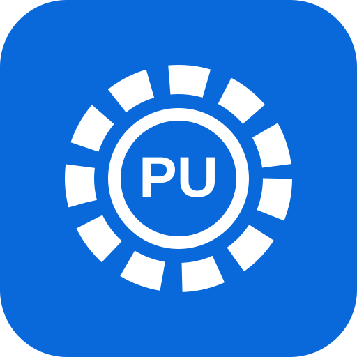

<p align="center">
  
</p>

# Parts Unlimited

Parts Unlimited is an educational software engineering project for practicing
project planning, documentation, continuous integration, and delivery workflows.

The project models an online auto-parts store and will be implemented as a
.NET 8 application. GitHub is used for source control, documentation, work
tracking, and CI. GanttPRO will be used for resource and delivery planning.

## Project goals

- maintain a clear and searchable project knowledge base;
- organize product work with issues, iterations, and project views;
- build and test the application automatically on every relevant change;
- visualize milestones, dependencies, and team workload;
- keep all implementation and planning artifacts traceable.

## Planned solution structure

```text
src/        application source code
tests/      automated tests
docs/       project documentation and wiki source
assets/     project branding and shared media
```

## Technology

- .NET 8
- ASP.NET Core
- GitHub Projects and Issues
- GitHub Actions
- GanttPRO

## Documentation

The initial project description is available on the [wiki home page](docs/wiki/Home.md).
The setup record for the first practical work is available in
[Practice 1.1](docs/practices/1.1-project-setup.md).

## Status

The private repository and project workspace have been initialized.
